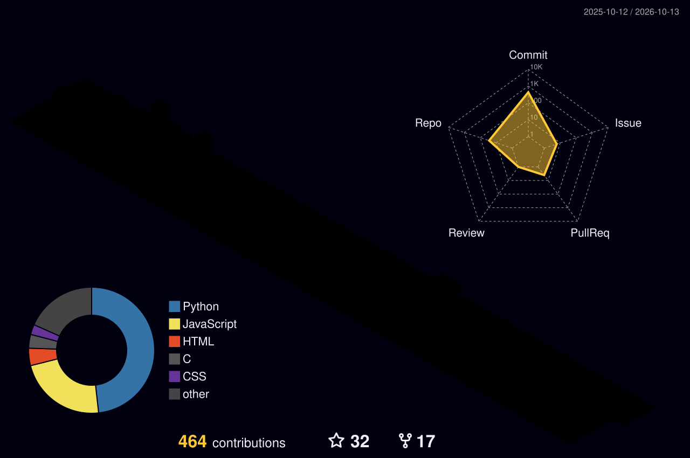

## Hi there! 👋 

<a href="https://git.io/typing-svg"></a>

🎓 Undergraduate in Automation @ Guangdong University of Technology  

📡 HAM Radio Enthusiast | Callsign: BG7KMT | HF/VHF/UHF & SDR & CW  

⚙️ Embedded Developer: AT89C52 | STM32 | ESP32 | MSPM0G3507    

🎹 Producer: Jazz | Future Bass | Complextro | Artcore  

🐍 Fool-stack Engineer | 🤖 OpenCV & YOLO | 🏹 Archery & 🏸 Badminton 

## 🛠️ Working Environment
<p align="center">
  <a href="https://www.jetbrains.com/clion/" target="_blank" rel="noopener noreferrer">
    
  </a>
  <a href="https://code.visualstudio.com/" target="_blank" rel="noopener noreferrer">
    
  </a>
  <a href="https://ubuntu.com/" target="_blank" rel="noopener noreferrer">
    
  </a>
</p>
<p align="center">
</p>


<!--START_SECTION:waka-->


**我是早鸟 🐤** 

```text
🌞 早晨                     266 commits         ⣿⣿⣿⣿⣿⣿⣿⣿⣀⣀⣀⣀⣀⣀⣀⣀⣀⣀⣀⣀⣀⣀⣀⣀⣀   30.30 % 
🌆 白天                     274 commits         ⣿⣿⣿⣿⣿⣿⣿⣿⣀⣀⣀⣀⣀⣀⣀⣀⣀⣀⣀⣀⣀⣀⣀⣀⣀   31.21 % 
🌃 傍晚                     242 commits         ⣿⣿⣿⣿⣿⣿⣿⣀⣀⣀⣀⣀⣀⣀⣀⣀⣀⣀⣀⣀⣀⣀⣀⣀⣀   27.56 % 
🌙 晚上                     96 commits          ⣿⣿⣿⣀⣀⣀⣀⣀⣀⣀⣀⣀⣀⣀⣀⣀⣀⣀⣀⣀⣀⣀⣀⣀⣀   10.93 % 
```
📅 **星期日 时的我最有干劲** 

```text
星期一                      146 commits         ⣿⣿⣿⣿⣀⣀⣀⣀⣀⣀⣀⣀⣀⣀⣀⣀⣀⣀⣀⣀⣀⣀⣀⣀⣀   16.63 % 
星期二                      112 commits         ⣿⣿⣿⣀⣀⣀⣀⣀⣀⣀⣀⣀⣀⣀⣀⣀⣀⣀⣀⣀⣀⣀⣀⣀⣀   12.76 % 
星期三                      94 commits          ⣿⣿⣿⣀⣀⣀⣀⣀⣀⣀⣀⣀⣀⣀⣀⣀⣀⣀⣀⣀⣀⣀⣀⣀⣀   10.71 % 
星期四                      133 commits         ⣿⣿⣿⣿⣀⣀⣀⣀⣀⣀⣀⣀⣀⣀⣀⣀⣀⣀⣀⣀⣀⣀⣀⣀⣀   15.15 % 
星期五                      129 commits         ⣿⣿⣿⣿⣀⣀⣀⣀⣀⣀⣀⣀⣀⣀⣀⣀⣀⣀⣀⣀⣀⣀⣀⣀⣀   14.69 % 
星期六                      79 commits          ⣿⣿⣀⣀⣀⣀⣀⣀⣀⣀⣀⣀⣀⣀⣀⣀⣀⣀⣀⣀⣀⣀⣀⣀⣀   09.00 % 
星期日                      185 commits         ⣿⣿⣿⣿⣿⣀⣀⣀⣀⣀⣀⣀⣀⣀⣀⣀⣀⣀⣀⣀⣀⣀⣀⣀⣀   21.07 % 
```


📊 **本周消耗时间** 

```text
🕑︎ 时区: Asia/Shanghai

💬 编程语言: 
Python                   23 mins             ⣿⣿⣿⣿⣿⣿⣿⣿⣿⣿⣀⣀⣀⣀⣀⣀⣀⣀⣀⣀⣀⣀⣀⣀⣀   40.11 % 
C                        19 mins             ⣿⣿⣿⣿⣿⣿⣿⣿⣀⣀⣀⣀⣀⣀⣀⣀⣀⣀⣀⣀⣀⣀⣀⣀⣀   33.70 % 
Markdown                 15 mins             ⣿⣿⣿⣿⣿⣿⣿⣀⣀⣀⣀⣀⣀⣀⣀⣀⣀⣀⣀⣀⣀⣀⣀⣀⣀   26.18 % 

🔥 编辑器: 
VS Code                  58 mins             ⣿⣿⣿⣿⣿⣿⣿⣿⣿⣿⣿⣿⣿⣿⣿⣿⣿⣿⣿⣿⣿⣿⣿⣿⣿   100.00 % 

💻 操作系统: 
Linux                    42 mins             ⣿⣿⣿⣿⣿⣿⣿⣿⣿⣿⣿⣿⣿⣿⣿⣿⣿⣿⣀⣀⣀⣀⣀⣀⣀   73.82 % 
Windows                  15 mins             ⣿⣿⣿⣿⣿⣿⣿⣀⣀⣀⣀⣀⣀⣀⣀⣀⣀⣀⣀⣀⣀⣀⣀⣀⣀   26.18 % 
```

🤖 **AI Coding This Week** 

```text
No AI Coding Activity Tracked This Week
```


 Last Updated on 31/10/2026 04:39:31 UTC
<!--END_SECTION:waka-->

> Make   <a href="https://archlinux.org/" target="_blank" rel="noopener noreferrer">
  </a> Great Again !  
> 
